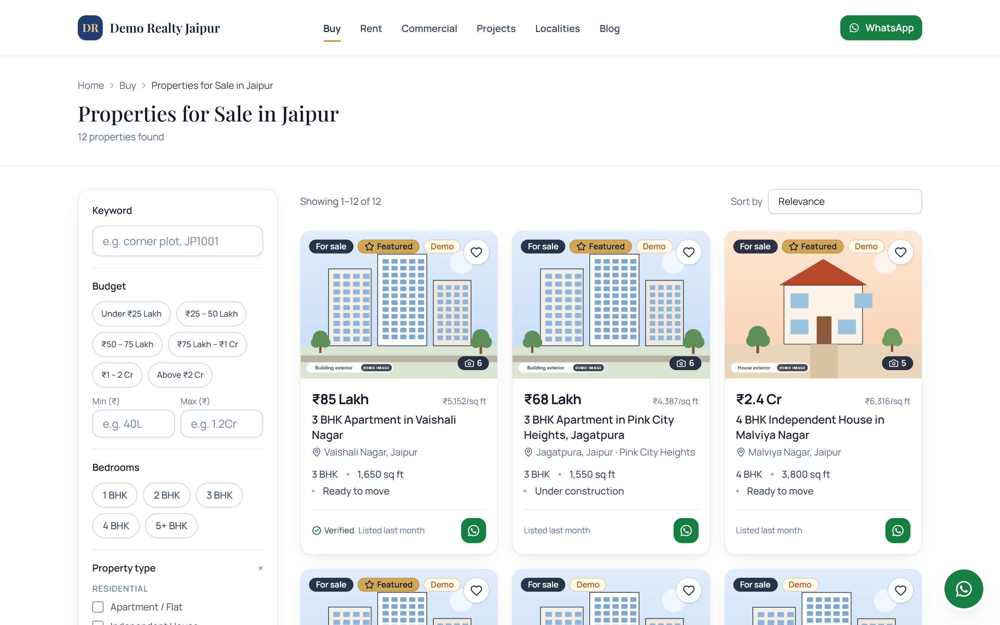
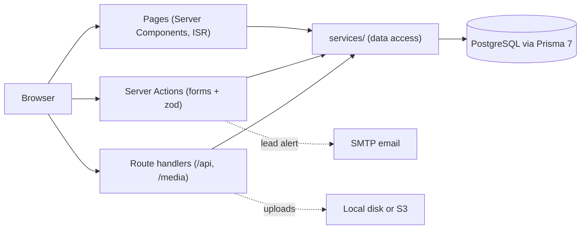
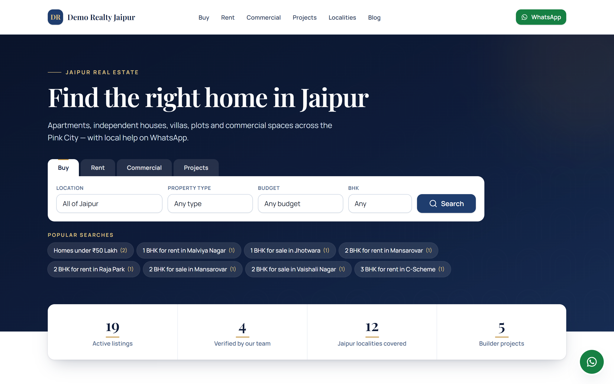
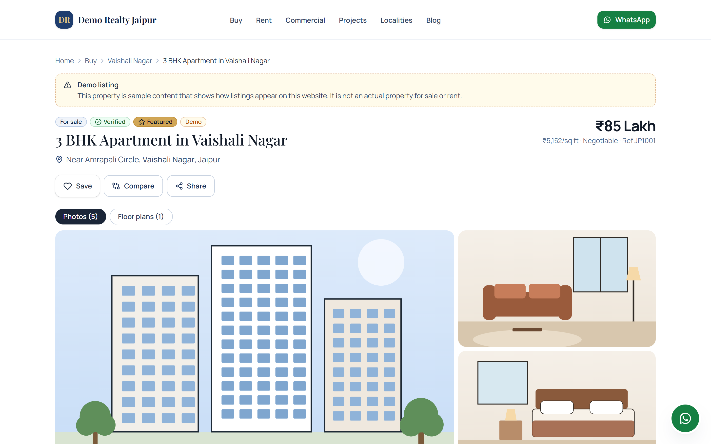
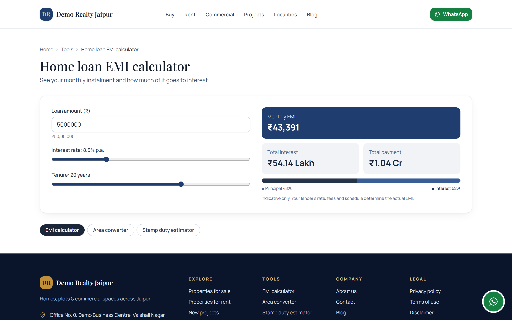

# Jaipur Realty

A full-stack real-estate website for Jaipur: property search for buyers and renters, lead capture
that feeds a small CRM, and an admin panel for the agency's staff.

**Live demo: [jaipur-realty.netlify.app](https://jaipur-realty.netlify.app)**. Every listing,
builder project, agent, blog post and testimonial on it is seeded demo data; listings carry a
visible "Demo" badge.



## What it's for

Buyers want to search Jaipur property by locality, budget in ₹ Lakh/Crore and BHK, then reach the
agency on WhatsApp or by phone. The agency needs every enquiry, call-back and site-visit request in
one place so that none is missed. This project does both: a public site for Jaipur's sale and
rental market, and an admin panel where staff manage listings and follow up on leads.

## Key features

- **Search the way Jaipur buyers do:** sale and rent listings filtered by locality, budget, BHK,
  property type, furnishing, construction status, area, facing and amenities, with 6 sort orders.
  Filters live in the URL so a search can be shared; shortlist and side-by-side compare included.
- **Every enquiry becomes a lead:** enquiry, call-back, brochure and site-visit forms (hourly slots
  for the next 14 days), prefilled WhatsApp links and a 4-step "list your property" form for owners.
- **No duplicate leads:** a repeat enquiry for the same listing within 24 hours is added to the
  existing lead's timeline. New leads are assigned to the listing's agent and trigger an email.
- **Admin panel with a small CRM:** dashboard, lead inbox with activity timeline, status and
  assignment, CSV export, site-visit scheduling, and owner submissions that convert into draft listings.
- **Content without a developer:** staff manage properties, builder projects, guides to 12 Jaipur
  localities, agents, a Markdown blog with scheduled publishing, FAQs and testimonials.
- **Buyer tools:** home-loan EMI calculator, area converter (sq ft, sq yd/gaj, bigha, acre) and
  stamp-duty estimator.

## Tech stack

- **App:** Next.js 16 (App Router, Server Components, Server Actions), React 19, TypeScript (strict)
- **UI:** Tailwind CSS 4, lucide-react
- **Data:** PostgreSQL 16+, Prisma 7 with the `pg` driver adapter, zod 4 validation
- **Server:** sharp (images), nodemailer (SMTP), bcryptjs (passwords)
- **Quality:** Vitest, ESLint 9
- **Deploy:** multi-stage Docker image, Docker Compose with Caddy (automatic HTTPS), Netlify config

## How it works



- Property, project, locality and blog pages are pre-rendered and refresh every 5 minutes, or
  straight away after an admin edit.
- Forms post to Server Actions that validate with zod, run spam checks, save through `services/`,
  and send the notification email after the response so the visitor never waits for it.
- Business name, phone, WhatsApp, email and address are read only from `.env` through `lib/config`,
  never hardcoded, so rebranding the site is a config change.

## Engineering highlights

- **Bad config fails the build, not the customer.** `next.config.ts` validates every public setting
  with zod and lists all problems at once; a malformed phone number or URL stops the build. It also
  refuses to allow search indexing while placeholder business details are still set.
- **Admin security.** Revocable database sessions storing only a SHA-256 hash of a 256-bit token,
  bcrypt (cost 12) with a dummy-hash check so login timing does not reveal which emails exist,
  rate-limited login, a role check in every admin action, and CSP/HSTS/X-Frame-Options headers.
- **Safe uploads.** sharp detects the real file type, fixes EXIF rotation, resizes to 2400 px and
  re-encodes to WebP, stripping GPS metadata. PDFs are checked by magic bytes; cross-origin uploads
  and path traversal are blocked. S3 uploads use a hand-written AWS SigV4 signer (no AWS SDK).
- **Spam protection that keeps real leads.** Honeypot, 3-second minimum fill time, 5-per-10-minute
  rate limit and optional Cloudflare Turnstile (fails closed). Visitors without JavaScript can still submit.
- **Privacy by default.** The client IP is read in a spoof-resistant way and visitors are counted by a
  daily-rotating salted hash; raw IPs are never stored. Analytics scripts load only when configured,
  with an optional consent banner. CSV export neutralises spreadsheet formula injection.
- **Technical SEO.** Explicit robots rules on every page, `noindex` on deep filter combinations,
  JSON-LD for listings, projects, FAQs and articles, dynamic share images, and demo records kept out
  of structured data and the sitemap. `robots.txt` blocks everything until indexing is switched on.
- **India-specific data model.** Prices are whole rupees in `BigInt` and display as Lakh/Crore; area
  is stored in sq ft; phone numbers are normalised to +91 format; dates are stored in UTC and shown
  in IST. One `isDemo` flag drives the badges, `noindex` and a one-command demo purge.
- **Deploy setup.** Non-root Docker image with a health check, `.env` passed as a build secret
  and kept out of the image, Postgres bound to localhost, and a `/api/health` database check. The
  Docker image is not yet built or tested; the live demo runs on Netlify.

## Screenshots

| Home | Search results |
|---|---|
|  |  |
| **Property page** | **EMI calculator** |
|  |  |

## Getting started

Requirements: Node.js ≥ 20.19 and PostgreSQL ≥ 16 (native, or `docker compose up -d`).

```bash
npm install                 # also runs `prisma generate`
cp .env.example .env        # then edit DATABASE_URL, AUTH_SECRET and business details
npm run db:migrate          # apply migrations
npm run db:seed             # demo data (safe to re-run)
npm run admin:create        # create the first admin login
npm run dev                 # http://localhost:3000
```

| Script | What it does |
|---|---|
| `npm run dev` / `build` / `start` | Next.js dev server / production build / production server |
| `npm run lint` · `typecheck` · `test` · `check` | Quality gates (`check` runs all three) |
| `npm run db:migrate` | Create/apply migrations in development |
| `npm run db:deploy` | Apply migrations in production |
| `npm run db:seed` | Seed demo data (idempotent) |
| `npm run db:reset` | Drop, re-migrate and re-seed (development only) |
| `npm run db:studio` | Browse the database |
| `npm run db:purge-demo` | Delete every `isDemo` record |
| `npm run admin:create` | Create an admin user, or reset a password (interactive) |
| `npm run placeholders` | Regenerate the demo SVG images |

**Tests:** 13 Vitest files cover Lakh/Crore price formatting and parsing, area units, Indian phone
numbers, search-URL round trips, lead validation and spam checks, IP handling, WhatsApp links, the
calculators and the seed data. There are no component or end-to-end tests yet.

**Production:** `npm run db:deploy && npm run build && npm start`. The build pre-renders pages
from the database, so migrate first; `NEXT_PUBLIC_*` values are baked in at build time. Docker
Compose (`Dockerfile`, `docker-compose.prod.yml` with Postgres and Caddy), VPS and serverless
setups are in [DEPLOYMENT.md](docs/DEPLOYMENT.md); serverless hosts need S3 for uploads. Rate
limiting is in memory per instance ([known limitations](docs/ASSUMPTIONS.md#6-known-limitations)).

<!-- TODO (Khushi): netlify.toml points to docs/DEPLOY_STEP_BY_STEP.md, but that guide covers Vercel, not Netlify. Add Netlify notes there if you want the live-demo setup documented. -->

### Where things live

```
app/          routes: (site) public pages, admin/ panel, api/ route handlers
components/   ui/ primitives, layout/, property/, project/, forms/, admin/, shared/
lib/          config/ (env → siteConfig), format/, whatsapp, constants/, seo/, auth/, actions/
services/     data access (pages and components never query the database directly)
prisma/       schema, migrations, seed + seed-data
scripts/      admin/demo/placeholder CLIs
docs/         spec, assumptions, plan, deployment guides, launch checklist
```

## Documentation

- [SPEC.md](docs/SPEC.md): product and technical specification
- [IMPLEMENTATION_PLAN.md](docs/IMPLEMENTATION_PLAN.md): architecture and phase-by-phase delivery log
- [ASSUMPTIONS.md](docs/ASSUMPTIONS.md): placeholders, defaults and known limitations
- [DEPLOYMENT.md](docs/DEPLOYMENT.md): VPS, Docker Compose and managed-platform options
- [DEPLOY_STEP_BY_STEP.md](docs/DEPLOY_STEP_BY_STEP.md): beginner guide (GitHub, Neon, Cloudflare R2, Vercel)
- [LAUNCH_CHECKLIST.md](docs/LAUNCH_CHECKLIST.md): what must be done before a real launch, including
  legal review of the policy pages and confirming stamp-duty rates

## My role

Built by Khushi Jaiswal with AI-assisted development (Claude Code), working phase by phase from a
written spec and implementation plan, each phase gated on lint, type-check, tests and a production build.

<!-- TODO (Khushi): Was this built for your employer or a client, or as your own project? Say which here, and if it was for an employer or client, confirm you are allowed to show it publicly. -->
<!-- TODO (Khushi): add 2-3 lines on what you personally decided, built or reviewed (for example the data model, the lead flow or the deploy setup), plus your LinkedIn or portfolio link. -->
